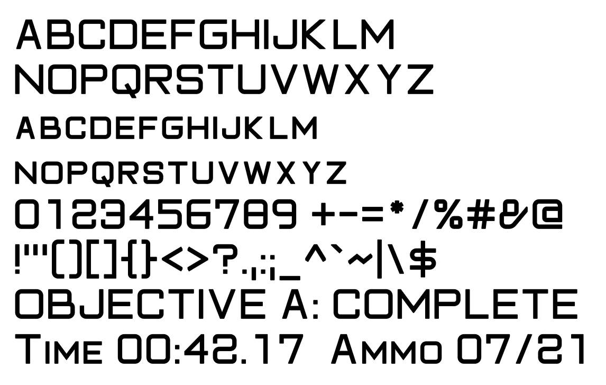

# Iron Sights assets

<!-- bright-builds-rules-readme-badges:begin -->

<!-- Managed upstream by bright-builds-rules. If this badge block needs a fix, open an upstream PR or issue instead of editing the downstream managed block. Keep repo-local README content outside this managed badge block. -->

[](https://github.com/pRizz/iron-sights-assets)
[](./LICENSE)
[](https://github.com/bright-builds-llc/bright-builds-rules)
[](https://openlinks.us/)

<!-- bright-builds-rules-readme-badges:end -->

Original, MIT-licensed fonts and game assets, drawn from scratch for
[Iron Sights](https://github.com/pRizz/Iron-Sights), a GoldenEye 007 PC and
browser port, and free for any other project to use.

**Status:** the title font is at v0.1 (a first draft for review); the body
font has not started. See [Roadmap](#roadmap).



## Why this exists

Iron Sights removed every bundled third-party art set in November 2026, because
their authors had not licensed them for bundling in ports or because they were
redrawn from the game's own art. The game now draws text with the low-resolution
fonts from the player's ROM, which stay soft on modern displays.

This repository replaces that with assets the project owns outright: drawn from
scratch, MIT licensed, and built reproducibly from their sources. Anyone may use
them, in Iron Sights, in other ports, in emulator packs or elsewhere.

## What's here

| Path | Holds |
| --- | --- |
| `fonts/title/` | The title font's glyph skeletons (`glyphs.py`) and parameters (`params.json`) |
| `tools/` | The generator: outline geometry, glyph pen, MSDF field, build and drift check |
| `tests/` | ROM-free checks: coverage, heights, clean contours, the font file, field validity and determinism |
| `dist/title/` | Built outputs: `IronSightsTitle-Regular.ttf`, `atlas.png` (MTSDF), `metrics.json`, `specimen.png` |

### Building

```bash
python -m pip install -r requirements.txt
python -m tools.build
python -m unittest discover -s tests -t .
python -m tools.check_dist
```

`tools.build` rewrites `dist/`; `tools.check_dist` fails if `dist/` differs
from a fresh build. CI runs the tests and the drift check on every push, and a
`v*` tag publishes a release with each font's files, the license and SHA-256
checksums.

### The title font

Squared geometric capitals for titles and HUD text. Each glyph is a few
centerline paths on a grid set by the cap height, width and stroke weight;
corners round by a bowl radius. The paths are stroked with mitered joins,
unioned, clipped to the glyph's band and slightly softened, all in exact
integer arithmetic (Clipper). Lowercase letters are small capitals built from
the same skeletons at a smaller height and weight. Figures share one width, so
changing numbers do not shift.

The atlas is a multi-channel signed distance field with the true distance in
alpha (MTSDF), generated by `tools/msdf.py` following the method of Viktor
Chlumsky's msdfgen: 48 pixels per em, a 6-pixel range. `metrics.json` gives
each glyph's advance, ink bounds, atlas cell and the cell's bounds in font
units. Text drawn from it stays sharp at any size, as in the specimen above.

### Planned layout for later assets

| Path | Holds |
| --- | --- |
| `fonts/<name>/` | Font sources: UFO outlines for drawn fonts, skeletons and parameters for generated ones |
| `tools/` | Generators and build scripts (sources to fonts, MSDF atlases and metrics) |
| `tests/` | Checks that run without any game ROM: glyph coverage, determinism, valid outputs |
| `dist/` | Built outputs, attached to tagged releases with SHA-256 checksums |

Builds are deterministic: CI rebuilds every output from its sources and fails
if anything differs from what is committed.

## Roadmap

1. **Title font** (squared geometric capitals, for titles and HUD text):
   generated by a parametric script, so any change regenerates every glyph.
2. **Body font** (a bold grotesque sans, for menus and briefings): drawn by
   hand as vector outlines.
3. **Releases** with TTF/OTF fonts, multi-channel signed distance field (MSDF)
   atlases and metrics JSON, which Iron Sights vendors at a pinned version.
4. **Later, other original game assets:** HUD icons, menu art and, eventually,
   environment and weapon textures and models. None of these is started; the
   layout and rules here are meant to cover them.

An exporter that builds an emulator texture pack from a player's own ROM is
possible later, but deferred. It would run on the player's machine, so this
repository never holds ROM-derived data.

Iron Sights tracks this work in its
[open assets plan](https://github.com/pRizz/Iron-Sights/blob/main/scripts/port/open_assets_plan.md).

## Rules for every asset

- **Drawn from scratch.** Every outline and drawing is made in our own
  sources. Never trace the game's art or fonts, or any texture or font pack
  (including packs marked CC0), and never copy their outlines, coordinates,
  pixels or metrics into this repository. The aim is to capture a general
  style, not to reproduce any existing design.
- **Comparing is allowed, locally.** The owner may compare our assets with the
  game's own, from their own copy, to judge how close the overall style is:
  for example Iron Sights' `scripts/port/compare_open_font.py`, which draws the
  game's glyphs beside ours with an overlay and a difference. Its output is
  game-derived and never enters this repository. Changes that a comparison
  informs are redrawn by hand in our sources, and their provenance note says a
  comparison informed them. Title font v0.1.0 was drawn before any comparison.
- **No ROM data.** Nothing read from a game ROM goes into this repository, not
  even glyph widths or texture checksums. Tools that need the ROM run on the
  user's machine and never commit what they read.
- **No game names on assets.** Fonts and files do not use the names of the
  game's fonts (such as Zurich or Bank Gothic) or of the game.
- **MIT only.** Assets derived from other open works keep their own license, so
  they cannot live here. They may be used as private development placeholders,
  but never committed or released.
- **Provenance.** Every contribution says who made it, from what and with which
  tools. See [CONTRIBUTING.md](CONTRIBUTING.md).

This is not legal advice. Typeface designs are protected in some countries and
not others, which is why everything here is drawn from scratch.

## License

[MIT](LICENSE). It covers everything in this repository: asset sources (font
outlines, drawings, parameter files), the generators and tools that build
them, and the outputs they produce (fonts, atlases, metrics, images).

This repository contains no material from GoldenEye 007 or any other game, and
no data read from a game ROM. Game names and trademarks in the documentation
belong to their owners and are used only to describe compatibility. This
project is not affiliated with or endorsed by Rare, Nintendo, MGM, EON or any
other rights holder.
